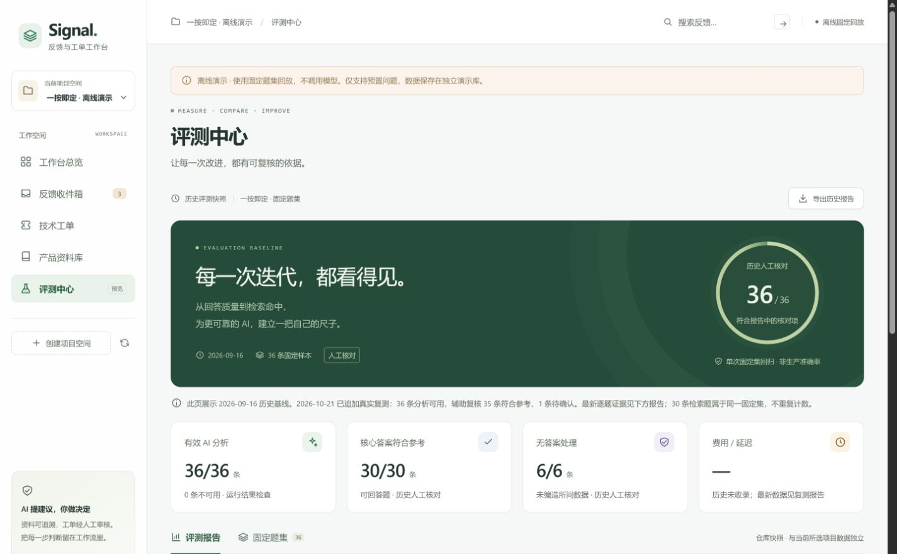
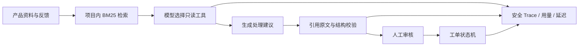

# Signal · AI 用户反馈与技术工单平台

[](https://github.com/abalika/signal-ai-feedback-platform/actions/workflows/ci.yml)

将产品资料、用户反馈、带引用的 AI 建议与人工审核后的工单接成一条可追踪流程。支持无需 API key 的离线演示，也支持在后端配置 OpenAI-compatible 模型服务。

**React 19 · TypeScript · FastAPI · SQLite · BM25 · Docker Compose**



## 这个项目解决什么问题

产品反馈常散落在聊天和表格中，开发者需要反复查规则、判断问题、组织回复并记录待办。Signal 将这一过程收进同一个工作台：模型只能选择白名单中的只读工具，回答需要经过引用原文校验，人工审核后才会产生技术工单。

试点资料来自作者自己的微信小程序「一按即定」的产品规则与工程测试。演示反馈明确标注为固定题集或模拟数据；项目没有声称真实企业部署、真实用户规模或业务提效。

## 可检查的工程能力

- **受控 AI 工作流**：规划只读工具 → 检索或人数规则核对 → 生成建议 → 校验引用；错误时显式降级，并记录安全错误代码。
- **可追溯的人工审批**：保留模型原建议、审核备注和最终标题；重复审批幂等；工单只允许待处理 → 处理中 → 完成，完成必须填写说明。
- **检索与观测**：中文单字/二元词及英文词 BM25，按项目隔离资料；记录模型阶段、耗时、token，以及聚合 P50/P95。
- **可重复评测**：一键离线回归、四类技术失败、JSON/HTML 报告及基线对比；真实模型结果另行采集和复核，区分回放、系统门禁与语义质量。
- **可交付性**：单端口离线演示、HTTP 冒烟、SQLite 一致性备份、锁定依赖、GitHub Actions，以及 Windows 便携包构建与完整性校验脚本。



## 验证结果与边界

| 范围 | 结果 | 含义 |
|---|---|---|
| 2026-10-24 后端自动化 | 96 项通过 | 输入边界、项目隔离、故障、事务、审批幂等、交付和隐私门禁 |
| 前端请求测试 | 7 项通过，lint/build 通过 | 超时、网络、HTTP 和异常响应处理 |
| 离线固定回归 | 36/36 流程、30/30 检索 Recall@1 | 同一小型固定题集，不合并计为 66 道独立题 |
| 2026-10-21 真实模型复测 | 36/36 分析可用；35 符合参考、1 待确认 | Codex 辅助逐题复核，尚非作者签字的人工准确率 |
| 真实调用观测 | 72 次请求，58,887 token，整条分析 P95 5.045 秒 | 当次本机运行；费用缺少网关价格，记为未知 |

未知题 6/6 没有编造所问数字、日期或设备结论。`known-25` 对具体人数条件的测试覆盖回答保守，参考答案粒度也有限，保留待复核。小型项目内题集不代表生产准确率；本次发布审查没有重新调用付费模型。

[真实复测报告](docs/真实接口复测-20261021.md) · [逐题 HTML](docs/reports/live-retest-20261021.html) · [机器汇总](examples/live_eval_summary_2026-10-21.json) · [最终公开审查](docs/公开发布审查-20261024.md)

## 三分钟启动离线演示

源码版需要 Python 3.12+、Node.js 22+。在项目根目录的 PowerShell 中运行：

```powershell
powershell -NoProfile -ExecutionPolicy Bypass -File scripts/setup.ps1
powershell -NoProfile -ExecutionPolicy Bypass -File scripts/start.ps1
```

打开 <http://127.0.0.1:8010>，无需 API key。默认使用独立的 `data/offline-demo.db` 和明确标记的固定回放，不把演示内容伪装成实时模型回答。

Linux/macOS 可执行：

```sh
python3 -m venv server/.venv
server/.venv/bin/python -m pip install -r server/requirements-lock.txt
cd app
npm ci
npm run build
cd ..
server/.venv/bin/python scripts/serve.py
```

推荐演示顺序：打开 `known-07` 反馈 → 播放固定演示 → 查看引用与 Trace → 人工确认建单 → 进入处理中并填写完成说明；再用 `unknown-01` 展示资料不足时拒绝建单。

## 验证与生成对比报告

```powershell
powershell -NoProfile -ExecutionPolicy Bypass -File scripts/verify.ps1
server/.venv/Scripts/python.exe scripts/evaluate.py --output work/eval-first
server/.venv/Scripts/python.exe scripts/evaluate.py --output work/eval-next --baseline work/eval-first/report.json
```

打开输出目录的 `report.html`。默认评测禁止真实模型网络调用、使用独立数据库；四类技术失败为检索、证据/格式、未知问题安全、工作流/运行错误。语义判断不由回放结果代替。题集或模式不一致时拒绝比较。

GitHub Actions 在干净环境中执行依赖安装、前端测试、lint/build、后端测试、隐私门禁、离线评测和 HTTP 部署冒烟。

## 可选：接入真实模型

参照 `server/.env.example` 在本机新建 `server/.env`，填写自己的 `OPENAI_API_KEY`、`OPENAI_BASE_URL` 和 `OPENAI_MODEL`，再运行：

```powershell
powershell -NoProfile -ExecutionPolicy Bypass -File scripts/start.ps1 -Live -Port 8012
```

真实模式使用独立的 `data/local-live.db`。密钥仅由后端读取，不进入前端。更换配置后重启服务。先用 `examples/run_eval.py --api-url http://127.0.0.1:8012 --limit 3` 小批量采集；该命令会产生真实模型用量，评分栏留待核对。

服务定位为本机单用户作品演示，尚无登录和多租户权限，默认只绑定 `127.0.0.1`。公开的是代码仓库；不应将无鉴权 API 直接暴露到公网。

## 目录与文档

| 路径 | 内容 |
|---|---|
| `app/` | React 工作台、前端请求层与测试 |
| `server/` | API、SQLite、检索、受控模型工作流与测试 |
| `examples/` | 来源可核对的资料、固定题集与脱敏结果 |
| `scripts/` | 安装、启动、评测、备份、冒烟、打包与隐私检查 |
| `docs/` | [用户手册](docs/用户手册.md)、[架构方案](docs/技术方案.md)、[简历条目](docs/项目展示与简历条目.md)、验收证据 |
| `API_CONTRACT.md` | 前后端接口约定 |

Docker、备份恢复及 Windows 便携包构建详见用户手册。便携包、数据库、`.env` 和原始工作日志不随公开源码上传。公开仓库从脱敏发布快照开始；旧验收文档中的维护标签和回退记录保留在本地维护仓库。
