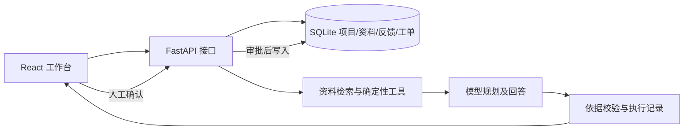

# 技术方案与面试追问准备

## 任务与边界

试点对象是作者自己的微信小程序，不是假定的企业客户。真实产品规则从代码与测试整理；用户反馈必须来自试用者或显式标记为模拟。平台帮助开发者处理反馈，不自动替开发者向外部用户答复，也不自动执行修复。

一次请求的目标是：判断反馈涉及的产品规则和可能任务，引用资料提出建议，保留执行记录，让开发者检查后决定是否建立工单。资料不足时输出待人工核实，而不是编造产品事实。

## 系统分层

模型负责理解语言和选择有限工具；规则核对、项目隔离、引用检查、状态变更由确定性代码负责。工具只提供有限的读操作。创建工单是单独的人工确认动作。这样能解释模型输出与真实系统状态之间的边界。

## 关键决策

- **先用可解释的检索基线**：文档量小，词项交集可直接检查。若固定测试显示召回不足，再加入中文分词、BM25、向量检索或重排；技术选型由测试证据驱动。
- **项目隔离**：文档与反馈都有 `project_id`。模型只获得对应项目的选中文档，不应借用别的产品资料。
- **保留 Bad Case**：模型输出引用的文档 ID 与原文必须校验；非法引用、模型超时、解析失败应记录并安全降级。
- **可观测而不泄密**：模型 Trace 只保留阶段、状态、耗时、模型标识和 token 计数；提示词、原始响应、推理内容和密钥不进入执行记录。
- **不把“有人审批”当成保障的全部**：审批前还需核对确实生成了有依据的 AI 建议，防止不可用模式被误写成工单。
- **不堆多 Agent**：单任务先用有限工具和清晰状态做稳。只有评测显示复杂任务无法完成时，才考虑更复杂的规划机制。

## 实习岗位可追问的问题

1. 为什么把数据库写入与模型调用分离？
2. 文档引用如何证明对应原文？匹配文字仍有哪些局限？
3. 模型 API 超时、资料缺失、重复点击确认分别怎样处理？
4. 当前检索策略为什么不直接使用向量数据库？什么时候需要升级？
5. 如果模型建议的任务不正确，开发者怎样发现和纠正？
6. AI 编程工具参与了哪些代码生成？本人怎样审查、测试和修复？

回答这些问题应以实际代码、测试和执行记录为依据。系统尚未产生真实试用效果与模型准确率，不能在面试或简历中提前声称。
