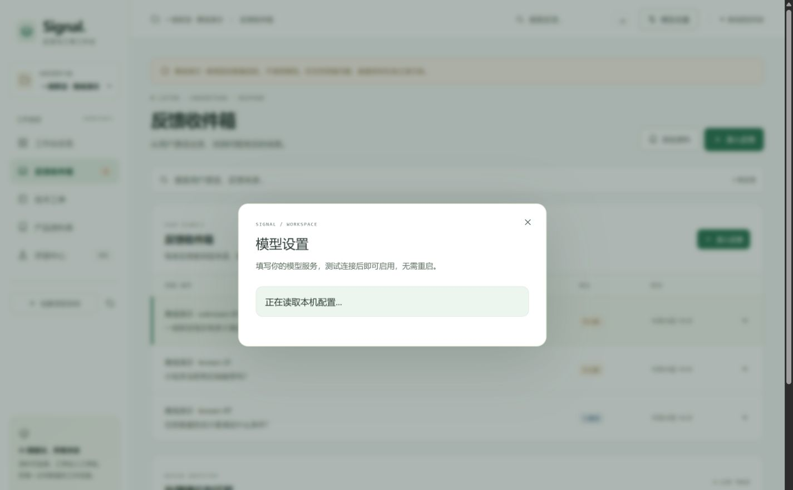

# 网页模型设置

2026-10-24 新增。无需编辑 `.env`，在工作台右上角打开“模型设置”，填写接口地址、模型名称和 API key，测试成功后保存并启用。

## 使用与数据边界

- 支持 OpenAI-compatible JSON Chat Completions；Base URL 由供应商提供，模型 ID 也需填写。
- 默认仅在后端进程内保留密钥。可选记住到数据库同目录的 `model-settings.json`；文件不加密，默认启动器重启后恢复上次保存模式。明确的离线评测不会自动启用已保存配置。
- 密钥不回显、不写浏览器存储、不记录到数据库 Trace；验证异常也不返回原始输入或供应商错误体。
- 改地址必须重新输入密钥，供应商重定向不跟随；写设置需本机 Host、可信 Origin 和会话防跨站令牌。
- 测试连接仅发送一次、输出上限 32 token、超时 12 秒，不自动重试；成功凭证五分钟有效，修改连接信息后需重新测试。
- 切回离线保留网页配置；删除网页配置会清除已记住文件并切回离线，不修改原环境配置。操作当前数据库，历史回放不会伪装成真实分析。
- 保存失败不改变当前生效配置。在途分析保留开始时的配置，后续请求使用新配置。

## 本轮验收

后端新增 30 项设置相关测试，总计 127 项；覆盖实时启用、真实业务路由使用新凭证、在途模式稳定、测试令牌绑定与过期、地址变更、凭证不回显、Origin/Host/防跨站限制、错误脱敏、记住/重启/删除、原环境保留、损坏配置恢复、磁盘失败回退、禁止重定向，以及发布/打包排除。

浏览器使用明确标记的本机 HTTP 测试服务，验证填写、测试、保存、清空输入、重新打开仍仅显示掩码、调用分析与删除后切回离线。此服务不是模型质量评测，不纳入真实模型成绩。

现有真实网关第一次探测失败时，界面正确提示且不启用；用户随后恢复网关，第二次探测成功（1,657 ms），保存后 `known-07` 真正完成两阶段分析，返回 `model_mode=ai` 和 1 条原文引用，两阶段共 1,637 token。这里只是功能集成验收，没有重跑 36 题或更新语义准确率。

截图与公开源码不含密钥；测试记录保存在维护目录 `work/model-settings-20261024/`，不上传。旧交付 ZIP 不包含本功能，使用更新后的源码构建运行。

补充修复直接模块启动的导入兼容，并通过子进程验证离线回放。容器构建上下文包含报告与评测资源，Nginx 保留本机 Host 以支持设置安全校验；Compose 配置校验通过。本机 Docker 引擎未运行，本轮未验证镜像构建或容器内调用。
