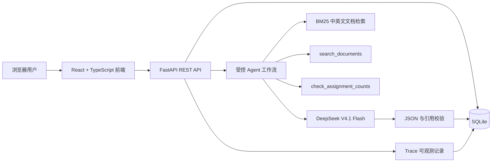
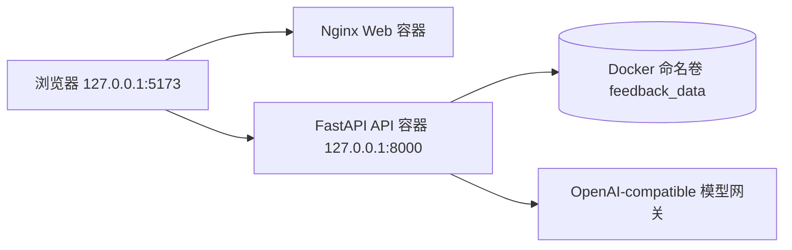
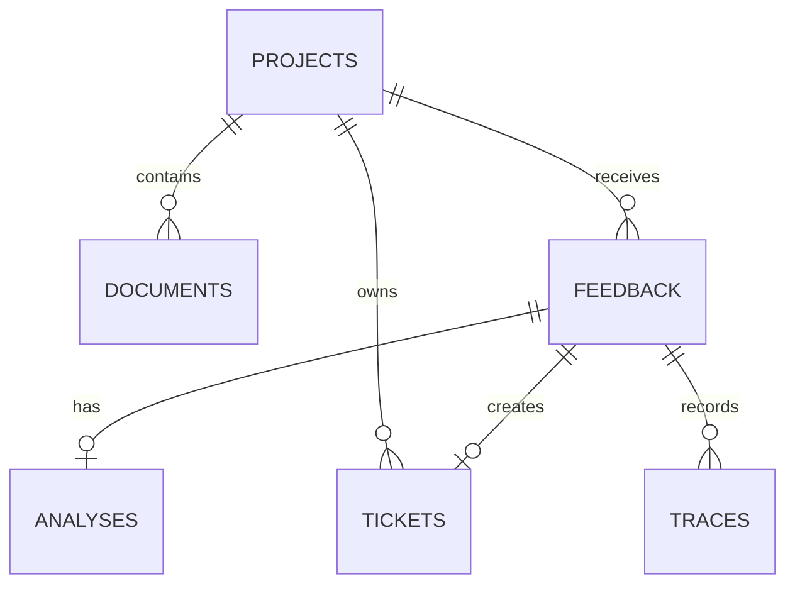
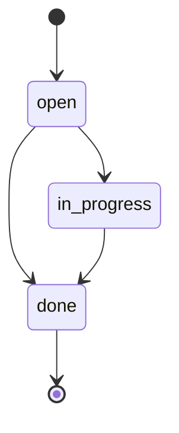

# AI 用户反馈与技术工单处理平台

## 项目完全理解与面试手册（零基础版）

> 适用岗位：AI 应用开发、Agent/智能体应用开发、AI 全栈、Python 后台开发、AI Coding/内部提效工具，以及偏技术的 AI 产品岗位。
>
> 源码目录：`<项目根目录>`
>
> 本地地址：<http://127.0.0.1:5173/>
>
> 最新发布审查：2026-10-24 后端 127 项、前端 7 项测试及 lint/build 通过，36 条离线流程与 30 条检索回归通过。2026-10-21 真实分析 36/36 可用，辅助复核 35 符合参考、1 待确认。下文部分数字属于开发阶段记录，最新口径以 README、公开发布审查及真实复测报告为准；容器验证为此前记录，本次未重建容器。

---

# 一、先用最简单的话理解这个项目

这是一个帮助开发者处理产品用户反馈的系统。

用户可能会说：

> “我给 3 个人分配了两个任务，一个任务 2 人、另一个任务 2 人，为什么不能开始？”

开发者收到这句话后，需要完成一连串工作：

1. 查产品规则。
2. 判断用户的问题属于 Bug、使用疑问还是功能建议。
3. 核对用户的数据是否符合规则。
4. 给用户一个有依据的回复。
5. 判断内部是否需要建立技术任务。
6. 人工确认 AI 的判断是否可靠。
7. 创建工单并跟踪处理。
8. 解决后记录处理结果。

本项目把这条流程放到同一个系统中，并让 AI 参与“理解、检索、工具选择、建议生成”，但不允许 AI 直接修改业务数据。

一句话介绍：

> 这是一个把产品资料、用户反馈、受控 Agent、引用校验、人工审核和技术工单串起来的 AI 应用平台。

它不是普通聊天机器人，因为它不只输出一段文字，还会：

- 查当前产品的资料；
- 选择只读工具；
- 执行确定性计算；
- 给出可核对的引用；
- 等待人工修改和确认；
- 生成可跟踪的工单；
- 记录整个执行过程。

---

# 二、为什么要做这个项目

## 2.1 真实痛点

小型产品或内部工具收到的反馈经常散落在微信、聊天记录、表格和口头沟通里。常见问题包括：

- 用户只描述现象，没有给出完整复现步骤；
- 开发者需要反复查产品规则；
- AI 可能编造不存在的功能或数据；
- AI 建议和最后真正执行的任务混在一起；
- 处理完成后没有留下原因、依据和结果；
- 团队无法知道模型用了什么工具、花了多少 token、为什么失败。

## 2.2 项目目标

本项目希望做到：

1. 反馈原文可保存。
2. 产品资料按项目隔离。
3. AI 只能使用当前项目资料。
4. Agent 只能调用白名单工具。
5. AI 回复必须带原文引用。
6. 写入工单前必须人工确认。
7. AI 原建议与人工最终决定分别保存。
8. 工单从待处理走到完成。
9. 模型调用、工具调用和错误都有 Trace。
10. 系统可以本地测试、Docker 部署和重复运行。

## 2.3 当前不做什么

项目有意控制了边界，目前不包含：

- 多人账号、登录与角色权限；
- 自动向真实用户发送消息；
- 让 Agent 任意执行命令或代码；
- 企业级全文检索集群；
- 自动修改源码并发布上线；
- 公开互联网部署；
- 商业营收或真实大规模用户数据。

面试时主动说明边界，比假装“企业级生产系统”更可信。

---

# 三、第一套试点数据从哪里来

项目使用本人开发的“一按即定”微信小程序作为第一套试点产品。

知识库资料来自现有小程序的代码、README 和测试，包含：

- 四种玩法：选一个人、排顺序、随机分组、分配任务；
- 任务名称和人数规则；
- 触点变化与倒计时规则；
- 结果页行为；
- 是否登录、是否有后端、是否保存历史；
- 导航重试、重复导航防护和页面栈测试。

这些产品规则是可从源码核对的真实资料。

当前演示反馈主要标记为“模拟演示”，固定评测问题标记为“固定评测题，非真实用户反馈”。它们不能被描述成真实用户量或运营成绩。

正确说法：

> 我用自己已有的小程序代码和测试建立了第一套可核对知识库，并用明确标记的模拟反馈和固定评测题验证系统。下一阶段会邀请真实试用者提交脱敏反馈。

错误说法：

> 这个平台已经服务了大量真实用户，并显著提升了公司的反馈处理效率。

---

# 四、整体架构



Docker 部署结构：



请求路径：

```text
浏览器
  → React 页面
  → /api/feedback/{id}/analyze
  → FastAPI
  → 读取 SQLite 中的反馈和当前项目资料
  → DeepSeek 选择工具
  → 后端验证并执行工具
  → DeepSeek 生成建议和引用
  → 后端验证引用
  → 保存 Analysis 和 Trace
  → 返回前端
```

---

# 五、使用了哪些技术，它们分别做什么

## 5.1 React

React 用来构建浏览器界面。项目页面包括：

- 项目空间切换；
- 产品资料库；
- 反馈收件箱；
- AI 分析检查器；
- 引用和执行时间线；
- 人工审核表单；
- 技术工单页面；
- 工单状态筛选。

React 的核心思想是：界面由状态决定。当 `feedback`、`analysis`、`tickets` 等状态变化时，页面自动重新渲染。

## 5.2 TypeScript

TypeScript 是带类型的 JavaScript。

项目为 `Project`、`Document`、`Feedback`、`Analysis`、`Ticket`、`Trace` 定义了类型。它可以提前发现：

- 字段名拼错；
- 把字符串当数字；
- API 少返回字段；
- 组件参数不一致。

## 5.3 Vite

Vite 负责前端开发服务器和生产构建。

常用命令：

```powershell
npm run dev
npm run build
npm run lint
```

## 5.4 FastAPI

FastAPI 是 Python Web 框架，负责：

- 定义 REST API；
- 接收前端 JSON；
- 调用数据库；
- 执行 Agent 工作流；
- 返回结构化响应；
- 自动进行请求校验。

入口文件：

```text
server/main.py
```

## 5.5 Pydantic

Pydantic 用于输入输出的数据模型校验。

例如：

- 项目名称不能为空；
- 文档内容有长度限制；
- 工单状态只能是 `open`、`in_progress`、`done`；
- 审核备注和解决说明不能无限长。

模型位于：

```text
server/schemas.py
```

## 5.6 SQLite

SQLite 是单文件关系数据库，优点是：

- 不需要单独安装数据库服务器；
- 易于本地演示；
- 支持事务和外键；
- 可以直接备份一个文件；
- 很适合个人项目和中小型内部工具。

缺点是高并发写入和水平扩展能力有限。如果变成多人生产系统，应迁移 PostgreSQL。

## 5.7 DeepSeek V4.1 Flash 与本地模型网关

模型 ID：

```text
cn:deepseek-v4.1-flash
```

用途：

1. 理解自然语言反馈。
2. 选择一个允许的工具。
3. 将工具结果和资料整理为结构化建议。

后端使用 OpenAI-compatible Chat Completions 接口，没有把模型 SDK 深度绑定到某一家供应商。本机通过 `127.0.0.1:7863/v1` 访问网关；Docker 容器不能把自己的 `127.0.0.1` 当作 Windows 主机，因此 Compose 改用 `host.docker.internal:7863/v1`。

## 5.8 Docker Compose

Docker 将运行环境封装成镜像，解决“我的电脑能运行，别人的电脑不能运行”的问题。

两个服务：

- `api`：Python 3.12 + FastAPI；
- `web`：Node 构建 React，Nginx 提供静态页面。

SQLite 数据放在命名卷 `feedback_data`，容器删除和重建后数据仍然保留。

## 5.9 Nginx

前端生产构建后生成静态 HTML、CSS 和 JavaScript。Nginx 负责高效提供这些文件，并支持单页应用路由回退。

## 5.10 Pytest、Oxlint 和 CI

- Pytest：后端自动化测试；
- Oxlint：前端代码检查；
- TypeScript/Vite build：类型和生产构建检查；
- GitHub Actions：推送或 Pull Request 时自动执行同样的检查。

---

# 六、源码目录怎么读

```text
AI用户反馈与技术工单平台/
├─ app/                       React 前端
│  ├─ src/App.tsx             页面总状态和业务动作
│  ├─ src/api.ts              HTTP 请求封装
│  ├─ src/types.ts            TypeScript 数据类型
│  ├─ src/ui.ts               日期、状态、文本辅助函数
│  └─ src/components/
│     ├─ AnalysisInspector.tsx  AI 建议、证据、Trace、人工审核
│     ├─ ProjectViews.tsx       工作台、资料、反馈、工单页面
│     └─ Shared.tsx             通用组件
├─ server/
│  ├─ main.py                 FastAPI 路由与业务事务
│  ├─ ai.py                   模型调用、工具和引用校验
│  ├─ retrieval.py            BM25 检索、旧基线和安全诊断
│  ├─ db.py                   SQLite 表、连接、事务和迁移
│  ├─ schemas.py              Pydantic 输入输出模型
│  └─ tests/                  27 项后端测试
├─ examples/
│  ├─ miniapp/                可核对的小程序资料
│  ├─ eval_cases.json         36 条固定评测题
│  ├─ run_eval.py             AI 评测执行脚本
│  └─ run_retrieval_eval.py   检索对比评测脚本
├─ docs/                      技术、评测、简历和试用文档
├─ compose.yml                Docker Compose
├─ scripts/verify.ps1         一键本地验证
└─ README.md                  项目总说明
```

推荐阅读顺序：

1. `README.md`
2. `API_CONTRACT.md`
3. `server/schemas.py`
4. `server/db.py`
5. `server/ai.py`
6. `server/main.py`
7. `app/src/App.tsx`
8. `app/src/components/AnalysisInspector.tsx`
9. `server/tests/`

---

# 七、数据库设计



## 7.1 projects

产品项目，例如“一按即定 · 产品试点”。

重要字段：

- `id`
- `name`
- `description`
- `created_at`

## 7.2 documents

当前项目知识库资料。

重要字段：

- `project_id`
- `title`
- `content`
- `created_at`

## 7.3 feedback

用户反馈原文。

状态包括：

- `new`
- `analyzed`
- `ticketed`

## 7.4 analyses

每条反馈最多保存一份当前分析，通过 `feedback_id` 一对一关联。

包含：

- 问题分类；
- 摘要；
- 建议回复；
- AI 建议任务；
- 引用 JSON；
- 是否需要复核；
- 模型模式；
- 更新时间。

重新分析同一反馈时使用 UPSERT 更新，不会不断产生重复 Analysis 行。

## 7.5 tickets

人工确认后的技术工单。

关键字段：

- `title`：人工最终标题；
- `original_proposed_task`：AI 原始建议快照；
- `reviewer_note`：人工审核备注；
- `status`：`open`、`in_progress`、`done`；
- `resolution_note`：完成说明；
- `created_at`、`updated_at`。

`feedback_id` 有 UNIQUE 约束，一条反馈最多对应一张工单，这是数据库层的幂等保障之一。

## 7.6 traces

记录分析和审核过程。

常见步骤：

- `retrieval`
- `model`
- `tool`
- `error`
- `review`
- `ticket_status`

Trace 不保存 API 密钥、完整提示词、原始模型响应或推理内容。

---

# 八、完整业务流程

## 8.1 创建项目

调用：

```http
POST /api/projects
```

项目用于隔离资料、反馈和工单。项目 A 的反馈不能读取项目 B 的文档。

## 8.2 添加资料

调用：

```http
POST /api/documents
```

资料应来自有权使用、能够核对的来源。

## 8.3 录入反馈

调用：

```http
POST /api/feedback
```

保存反馈原文和来源，不先让 AI 改写，便于以后核对。

## 8.4 请求 AI 分析

调用：

```http
POST /api/feedback/{id}/analyze
```

后端步骤：

1. 查询反馈。
2. 查询相同 `project_id` 下的资料。
3. 做一次确定性初始检索。
4. 记录 retrieval Trace。
5. 判断 DeepSeek 是否配置。
6. 第一轮模型调用：选择一个工具。
7. 后端验证工具名和参数。
8. 执行只读工具。
9. 记录 tool Trace。
10. 第二轮模型调用：生成结构化建议。
11. 解析 JSON。
12. 校验引用。
13. 保存 Analysis。
14. 更新 Feedback 状态。

## 8.5 人工审核

人工要核对：

- 用户原话；
- AI 摘要；
- AI 建议回复；
- AI 建议任务；
- 资料引用；
- 最终工单标题；
- 审核备注。

修改内容后必须重新勾选确认。

## 8.6 创建工单

调用：

```http
POST /api/feedback/{id}/approve
```

只有满足以下条件才能创建：

- 已有 Analysis；
- `model_mode == ai`；
- 至少存在一条通过校验的引用；
- AI 建议任务非空；
- 人工显式确认。

重复审批返回原工单，不会创建重复记录，也不会覆盖第一次人工决定。

## 8.7 工单状态机



规则：

- 已完成是终态，不能回退；
- 完成必须填写解决说明；
- 请求更新为当前状态是幂等操作；
- 真正发生变化才记录 `ticket_status` Trace。

---

# 九、Agent 到底是怎么工作的

## 9.1 这里的 Agent 是什么

这里的 Agent 可以理解为：

> 模型根据目标选择一个工具，后端执行工具，再把工具结果交回模型完成任务。

它不是无限自主 Agent，也不是多 Agent 团队。

流程是：

```text
用户反馈
→ LLM 选择工具
→ 后端验证计划
→ 后端执行只读工具
→ LLM 根据工具结果和资料生成建议
```

## 9.2 为什么调用两次模型

第一次专门做工具规划，输出类似：

```json
{
  "tool": "check_assignment_counts",
  "arguments": {
    "participant_count": 3,
    "task_counts": [2, 2]
  }
}
```

后端执行后得到：

```json
{
  "assigned_total": 4,
  "valid": false,
  "difference": 1
}
```

第二次模型根据结果生成建议。

这样比“一次模型调用包办所有事情”更容易观察和测试。

## 9.3 工具一：search_documents

作用：从当前项目资料中找相关内容。

限制：

- query 必须是非空字符串；
- 最多 500 字符；
- 只能访问当前项目资料；
- 最多返回 5 份文档。

## 9.4 工具二：check_assignment_counts

作用：确定性计算任务人数总和。

限制：

- 参与者人数必须为 1–1000；
- 任务项数量为 1–6；
- 每个任务人数为 1–1000 的整数。

返回：

- `assigned_total`
- `valid`
- `difference`

## 9.5 为什么工具必须由后端执行

模型输出是概率性的，不能直接信任。

后端负责：

- 工具白名单；
- 参数类型检查；
- 长度和数值范围限制；
- 拒绝未知工具；
- 禁止工具写数据库；
- 禁止任意代码执行。

即使模型输出 `delete_ticket` 或系统命令，后端也不会执行。

---

# 十、检索与 RAG

## 10.1 RAG 是什么

RAG 是 Retrieval-Augmented Generation，中文常称“检索增强生成”。

模型回答前先从外部资料中检索上下文，然后根据资料生成答案。

## 10.2 本项目怎样检索

当前使用无外部依赖、可解释的 BM25 检索：

1. 英文、数字和下划线按词提取；
2. 中文同时提取单字和相邻二元词，兼顾召回与短语含义；
3. BM25 综合词频、词在文档集合中的稀有程度和文档长度；
4. 中文二元词与标题获得适度加权；
5. 按得分排序并取前 5 份，同时在 Trace 中记录算法版本、分数与命中词数。

优点：

- 无额外服务；
- 结果可解释；
- 测试容易；
- 适合当前少量文档。

缺点：

- 不理解同义词；
- 没有真正的中文分词与同义词扩展；
- 大规模文档性能和召回有限；
- 没有 Embedding、向量数据库和 Rerank。

面试回答：

> 我没有为了堆技术直接引入向量数据库。当前知识库只有少量规则文档，我先把交集基线升级为中文二元词 BM25，并建立 30 条检索固定集。旧方法 Recall@1 是 29/30，当前实现是 30/30；因为只有 2 份资料，这只是回归结果，不是生产准确率。规模扩大后我会比较 Embedding 混合召回和 Rerank，并同时看 Recall、引用正确率、延迟和成本。

---

# 十一、引用校验与防幻觉

模型返回引用时需要给出：

```json
{
  "document_id": 1,
  "excerpt": "文档中的连续原文"
}
```

后端检查：

1. 文档 ID 是否属于本次检索结果；
2. excerpt 是否非空；
3. 清理空白后，excerpt 是否真实存在于该文档；
4. 同一文档是否重复引用；
5. 引用数量是否超过上限。

如果摘要、回复、任务或有效引用缺失，本次分析会降级为 unavailable，不会伪造成功结果。

重要限制：

> “引用文字存在”只能证明模型没有虚构这段文字，不能完全证明这段文字与当前结论高度相关。

因此最终仍需人工审核引用相关性。

---

# 十二、人工审核为什么重要

这个系统采用 Human-in-the-loop。

人工审核能够解决：

- AI 分类错误；
- 引用虽然存在但关联不强；
- 工单标题不够可执行；
- 用户回复语气不合适；
- AI 不知道团队当前优先级；
- 真实设备问题需要更多信息。

数据库分别保存：

- `original_proposed_task`：AI 原建议；
- `title`：人工最终标题；
- `reviewer_note`：人工修改原因；
- `resolution_note`：最终解决说明。

这能回答面试官常问的问题：

> 如何证明人工不是形式化地勾选一下？

回答：

> 系统不仅有确认按钮，还分别持久化 AI 建议与人工最终内容，内容修改后确认状态会重置；审核写入 Trace，工单处理完成还必须填写解决说明。

---

# 十三、可观测性

系统记录每一步：

```text
retrieval → model(tool_plan) → tool → model(recommendation) → review → ticket_status
```

模型 Trace 只保存白名单元数据：

- 阶段；
- 状态；
- 实际模型标识；
- 耗时毫秒；
- prompt tokens；
- completion tokens；
- total tokens；
- 安全错误码。

不保存：

- API Key；
- 完整提示词；
- 原始响应 body；
- 模型推理内容；
- 用户隐私日志。

实际一次演示曾记录：

```text
工具规划：814 ms / 499 tokens
生成建议：1220 ms / 1105 tokens
累计：2034 ms / 1604 tokens
```

这些数字只能作为单次演示，不代表稳定的生产 SLA。

总览还会调用 `/api/metrics?project_id=...`，按项目聚合：

- 模型调用次数；
- token 总量；
- 模型耗时 P50/P95；
- AI 分析数、已建工单数和建议转工单率；
- 完成工单数。

该接口只读取计数以及 Trace 中允许公开的数字字段，不返回反馈原文、提示词、模型回答、推理内容或密钥。P50 反映典型耗时，P95 更适合观察慢请求；当前样本量小时，两者只能用于开发观测，不能包装成生产 SLA。

---

# 十四、错误处理与降级

## 14.1 未配置模型

`/api/health` 返回 `ai_configured=false`。

系统仍可管理项目、资料、反馈和工单，但分析明确显示 unavailable，不会生成模拟 AI 结果。

## 14.2 没有资料

系统拒绝生成“有依据”的建议，并记录错误 Trace。

## 14.3 模型选择非法工具

后端拒绝计划，回退到确定性文档检索，不执行未知操作。

## 14.4 模型返回非法 JSON

解析失败，记录安全错误码并降级。

## 14.5 DeepSeek 空内容

DeepSeek JSON 模式可能偶发返回空 content。系统最多做一次有限重试，防止无限重试和费用失控。

## 14.6 网络或 429/5xx

部分暂时性错误有限重试；401 等认证错误不重复请求。

## 14.7 引用不合法

不属于本次文档或原文不存在的引用会被过滤。没有有效引用就不能创建工单。

---

# 十五、幂等、事务和并发

## 15.1 什么是幂等

相同请求执行多次，最终结果与执行一次相同。

项目中的例子：

- 重复审批同一反馈返回原工单；
- 不产生重复工单；
- 不覆盖第一次人工审核；
- 不重复写审核 Trace；
- 请求更新为当前工单状态不重复写状态 Trace。

## 15.2 数据库怎样保证

- `tickets.feedback_id` 有 UNIQUE；
- 写操作使用 SQLite 事务；
- `BEGIN IMMEDIATE` 序列化本地写事务；
- 失败时 rollback；
- 外键开启并支持级联删除；
- 连接设置 busy timeout。

## 15.3 前端怎样避免竞态

快速切换项目或反馈时，旧请求可能晚于新请求返回。

前端使用请求序号 Ref：只有最新请求才可以更新页面，从而避免把项目 A 的数据显示到项目 B。

---

# 十六、测试和评测不是一回事

## 16.1 后端自动化测试：27 项

测试代码：

```text
server/tests/test_api.py
server/tests/test_provider.py
```

覆盖：

- 健康检查；
- SQLite 持久化；
- 项目隔离；
- 内存数据库；
- 未配置 AI 的诚实降级；
- Analysis 跨实例读取；
- 审批前置条件；
- 审批幂等；
- 人工覆盖和审核 Trace；
- 非法审核输入；
- 工单合法状态迁移；
- 非法回退和终态保护；
- 完成说明校验；
- 状态更新幂等；
- 旧数据库迁移；
- 引用过滤；
- 工具计划与参数；
- 工具只读边界；
- 非法工具回退；
- 模型失败；
- 429/5xx 重试；
- 401 不重试；
- 空 JSON 重试；
- token 元数据隐私。

这些是代码行为测试。

## 16.2 AI 固定集评测：36 条

```text
examples/eval_cases.json
```

- 30 条资料中有答案；
- 6 条故意无答案，例如用户量、收入、上架日期、所有机型稳定性。

初始评测暴露了：

- 有效人数规则被错误表达为全部条件通过；
- 空 JSON；
- 无答案场景出现多余推断；
- 引用相关性问题。

修改提示和重试逻辑后，最终一次固定回归中：

- 36/36 返回 AI 分析；
- 30 条核心答案符合参考答案；
- 6 条无答案题没有编造所问事实。

正确表述：

> 在当前固定资料、固定题集的一次人工核对回归中通过 36 条用例。

不能说：

> 模型生产准确率 100%。

---

# 十七、Docker 与部署

## 17.1 Compose 服务

`api`：

- Python 3.12 slim；
- FastAPI；
- 端口仅绑定 `127.0.0.1:8000`；
- 健康检查 `/api/health`；
- SQLite 挂载到 `/data/app.db`。

`web`：

- Node 22 Alpine 多阶段构建；
- 最终使用 Nginx 1.27 Alpine；
- 端口仅绑定 `127.0.0.1:5173`；
- 依赖 API healthy 后启动。

## 17.2 为什么使用命名卷

```text
feedback_data:/data
```

容器可以删除和重建，但数据库仍留在卷里。

## 17.3 为什么不开放公网

当前系统没有：

- 登录；
- 用户身份；
- 项目权限；
- HTTPS；
- CSRF/公网安全策略；
- 生产备份和监控。

因此 Compose 只绑定本机地址。

## 17.4 Docker Desktop 特殊说明

当前 Windows 环境曾遇到两类 Docker Desktop 启动问题：Launcher 注册表主键缺失，以及由 Codex Desktop 进程启动 Docker 时，MSIX AppData 虚拟化使 `sailor-ingest.sock` 无法改名并报 1920。后者与项目代码和 SQLite 数据无关。

正确做法是从 Windows“开始”菜单或桌面资料包手动启动 Docker，等待 Engine running 后再启动项目。不要让 Codex 代替本人启动 Docker；遇到该弹窗应点 `Quit`，不要点 `Reset to factory defaults`。仍失败时完整重启 Windows，并在打开 Codex 前先启动 Docker。日常重建容器不会删除命名卷；只有 `docker compose down -v` 等显式删卷操作会删除项目数据。

---

# 十八、项目最有价值的设计点

## 优点

1. 解决完整业务流程，不是单页 Demo。
2. Agent 工具有明确白名单和参数边界。
3. AI 不能直接写业务数据。
4. 有文档引用和原文校验。
5. AI 建议与人工决定分别保存。
6. 有工单状态机和解决说明。
7. 有 Trace、耗时和 token 可观测。
8. 有 Bad Case、修复和复测证据。
9. 有自动化测试、CI 和 Docker。
10. 数据来源和模拟边界写得清楚。

## 缺点

1. BM25 仍不能理解同义词和深层语义，当前评测语料规模很小。
2. 没有登录和权限管理。
3. SQLite 不适合高并发生产场景。
4. 引用校验只能保证文字存在，不能完全保证语义相关。
5. 工具数量只有两个。
6. 没有真实大规模用户数据。
7. 没有公网部署与线上 SLA。
8. 没有异步任务队列，模型请求期间接口同步等待。
9. 没有缓存和请求成本预算控制。
10. 前端还没有完整的编辑/删除和分页能力。

---

# 十九、如果项目规模扩大，怎样升级

## 数据扩大

- SQLite → PostgreSQL；
- 增加分页和索引；
- Redis 缓存；
- 对模型任务使用 Celery/RQ/消息队列。

## 文档扩大

- 文档切片；
- BM25 保留为可解释关键词基线；
- Embedding；
- 向量数据库；
- 关键词+向量混合召回；
- Rerank；
- 按固定集评测 Recall@K 和引用正确率。

## 多用户

- 登录；
- JWT/Session；
- 用户—项目权限表；
- 所有查询强制按 user/project 过滤；
- 审核角色和只读角色；
- 审计日志。

## 生产部署

- HTTPS；
- Secret Manager；
- PostgreSQL 备份；
- Prometheus/Grafana；
- Sentry；
- 限流；
- 成本预算；
- Prompt 和评测版本管理；
- 蓝绿/灰度发布。

---

# 二十、三分钟面试演示话术

## 第 0–30 秒：背景

> 我做的是一套 AI 用户反馈与技术工单平台。它使用我自己的微信小程序作为第一套试点，将用户反馈、产品资料、Agent 工具调用、人工审核和工单处理串成一个可追踪流程。

## 第 30–90 秒：Agent

打开“3 人配置 2+2 任务”的反馈：

> 模型第一轮只负责选择工具。后端验证后执行 `check_assignment_counts`，得到总分配人数 4、参与人数 3、差值 1。第二轮模型根据确定性结果和产品文档生成建议。引用必须能在本次检索资料中找到原文。

## 第 90–140 秒：人工审核

> AI 没有写权限。我可以修改最终工单标题，填写审核备注；一旦内容变化，确认勾选会重置。数据库同时保留 AI 原任务和人工最终决定。

## 第 140–170 秒：工单闭环

> 工单采用 open、in_progress、done 的单向状态机。完成必须填写解决说明，终态不能回退，相同请求幂等。

## 第 170–180 秒：工程能力

> 系统记录每次模型和工具调用的耗时、token 和安全错误码，并按项目聚合 P50/P95 延迟、token 与建议转工单率；有 27 项自动化测试、36 条 AI 固定评测、30 条检索固定集、GitHub Actions 和 Docker Compose 部署。

---

# 二十一、十分钟技术讲解顺序

1. 业务问题和边界。
2. 架构图。
3. 数据库表关系。
4. 两阶段 Agent。
5. 工具白名单与参数验证。
6. 确定性检索和引用校验。
7. Human-in-the-loop。
8. 幂等和工单状态机。
9. Trace、耗时和 token。
10. 自动化测试与 AI 评测的区别。
11. Docker 和数据持久化。
12. 局限和下一步。

---

# 二十二、常见面试题与回答要点

## 1. 请介绍这个项目

> 这是一个 AI 用户反馈与技术工单平台。用户反馈进入系统后，Agent 先选择文档检索或人数核对工具，后端验证并执行只读工具，再由模型生成带依据的回复和任务建议。人工确认后创建工单，工单经过处理中到完成，全链路留下 Trace。前端用 React/TypeScript，后端用 FastAPI/SQLite，使用 DeepSeek 和 Docker Compose。

## 2. 为什么选这个项目

> 我希望做一个能同时证明 AI 应用、后端、前端、数据和工程交付能力的作品。用户反馈处理同时包含非结构化文本、业务规则、AI 不确定性和人工决策，适合展示可靠 AI 应用。

## 3. 它和普通知识库问答有什么不同

> 普通知识库问答只返回文字。本项目有任务型流程：工具规划、确定性计算、引用校验、人工审批、工单状态机和审计 Trace。

## 4. 为什么称为 Agent

> 模型不是固定执行同一步，而是根据反馈选择一个允许工具，后端执行后把观察结果返回模型继续完成任务。但它是受限单 Agent，不是无限自主系统。

## 5. 为什么不用多 Agent

> 当前任务链很短，多 Agent 会增加 token、延迟和调试难度。先把单 Agent 的工具调用、评测、人工审核和失败恢复做稳。如果未来任务出现并行研究、独立角色或长任务，再考虑多 Agent。

## 6. 为什么不直接用 LangChain/LangGraph

> 当前流程简单，我直接实现状态和工具边界，便于理解、测试和解释，减少框架隐藏行为。需要长任务恢复、复杂分支或大量节点时再引入 LangGraph。

## 7. 为什么不用向量数据库

> 当前只有少量规则文档，确定性检索成本低、可解释且容易测。是否升级应由固定测试的召回问题驱动，不是为了堆技术名词。

## 8. 检索算法有什么问题

> 当前 BM25 同时使用中文单字和二元词，比初版交集排序更稳定，但仍缺乏同义词和语义能力。当前检索固定集只有 2 份资料、30 道题；下一步应增加真实查询，再比较 BM25、Embedding 混合召回和 Rerank。

## 9. 怎样防止幻觉

> 限定项目资料、使用只读工具、要求结构化 JSON、验证文档 ID 和引用原文、缺少有效引用则降级、写操作必须人工确认。同时承认这些措施不能完全判断语义相关性。

## 10. 为什么 AI 不能直接创建工单

> 模型是概率系统，可能误判。写操作具有实际业务影响，因此通过独立审批接口和人工确认把生成与执行分开。

## 11. 工具调用安全吗

> 工具名必须在白名单中，参数有类型、长度和范围限制，工具都是只读确定性函数，不开放任意 HTTP、Shell、文件或数据库写能力。

## 12. 为什么要调用两次模型

> 将“选工具”和“生成答案”分开，能单独观察计划与回答，工具结果可确定性验证，也便于定位问题和评测。

## 13. 怎样保证引用真实

> 后端只接受本次检索文档 ID，清理空白后检查 excerpt 是否是文档正文的连续子串。不通过的引用被丢弃。

## 14. 引用真实就代表答案正确吗

> 不代表。引用可能存在但不相关，所以还需要人工审核，后续也可以加入引用相关性评测和 Rerank。

## 15. 幂等怎样实现

> 数据库对 feedback_id 加 UNIQUE；审批事务先查询已有工单；存在则直接返回。状态更新为当前状态也是 no-op，不新增 Trace。

## 16. 为什么要保存 AI 原建议

> 可以比较 AI 和人工最终决策，证明审核发生了，也便于复盘模型问题，而不是只保存被人工改过的最终结果。

## 17. 为什么使用状态机

> 明确合法迁移，防止已完成工单无意回退。状态变化和解决说明写在同一事务中，便于审计。

## 18. SQLite 有什么取舍

> 本地零运维、单文件、事务完整，适合个人作品；不适合多实例高并发写入，生产版会迁移 PostgreSQL。

## 19. 怎样处理模型 API 失败

> 临时网络和部分 429/5xx 最多重试一次；认证错误不重试；空 JSON 有有限重试；最终失败返回 unavailable，不制造假结果。

## 20. 怎样控制成本

> 文档数量和长度有界、最多 5 份、输出 token 有上限、只有两次模型调用、记录每阶段 token。未来可增加缓存、预算和小模型路由。

## 21. 测试与评测有什么不同

> 自动化测试验证代码规则，例如幂等、迁移、工具边界；AI 评测验证非确定性输出，例如答案、拒答和引用。两者不能互相替代。

## 22. 36/36 是否等于准确率 100%

> 不是。只是当前固定集的一次回归和人工核对，样本小、场景有限。不能当作生产准确率或真实用户效果。

## 23. 最困难的问题是什么

> 一类是模型空 JSON、无答案附加推断和人数规则误判；通过保存 Bad Case、增加边界提示、有限重试和确定性工具解决。另一类是 Docker Desktop Windows 安装器缺少注册表键，通过数据备份和官方 backend/frontend 修复入口解决。

## 24. AI 帮你写了多少代码

> 项目使用 AI 辅助需求拆解、代码生成、审查和排错，但我保留了接口契约、固定测试、真实运行验证和失败样本。面试时我能解释请求路径、数据库、工具边界、测试与每个关键取舍。

## 25. 项目如何证明是你理解的

> 我可以现场从反馈开始演示工具选择、Trace、人工审核和工单状态，并解释对应源码函数、数据库表和错误处理；也能讲出不适合当前规模的技术和升级条件。

## 26. 如果有一万份文档怎么办

> 文档切片、BM25/向量混合召回、Rerank、元数据过滤、异步索引、召回评测和缓存。SQLite 换 PostgreSQL/专用向量库。

## 27. 如果同时有很多用户怎么办

> 登录和项目权限、PostgreSQL、连接池、异步任务队列、限流、幂等键、横向扩展 API、集中日志和监控。

## 28. 为什么不自动回复用户

> 对外沟通有声誉和业务风险。当前只生成建议，人工确认。未来也应按照置信度和场景分级，低风险模板回复才能考虑自动化。

## 29. 项目怎样保护密钥

> 密钥仅在 `server/.env`，被 Git 和 Docker 构建上下文忽略；前端不持有密钥，镜像中也验证没有 `.env`。

## 30. 下一步最重要的是什么

> 收集经同意、脱敏的真实试用反馈，完成“真实问题—复现—修复—回归—复测”闭环，而不是继续堆功能。

---

# 二十三、简历写法

## 项目标题

**AI 用户反馈与技术工单处理平台｜独立开发（AI 辅助）**

## 简历描述

> 开发 React/TypeScript 工作台与 FastAPI/SQLite 服务，实现产品资料、用户反馈、AI 分析、人工审核及工单处理闭环；实现中文二元词 BM25、受控工具选择、引用原文校验、按项目聚合的 P50/P95 延迟与 token 观测、可编辑人工审批及单向工单状态机；使用 Docker Compose 完成镜像、健康检查和数据卷部署；建立 36 条 AI 固定集与 30 条检索固定集，针对空响应、无依据推断和排序错误完成 Bad Case 修复，并通过 27 项后端自动化测试。

## 不能写进简历的内容

- “服务了大量用户”；
- “商业化落地”；
- “生产准确率 100%”；
- “节省了 80% 人力”；
- “企业内部正式使用”；
- “自动修复 Bug”；
- 任何没有记录支持的数字。

---

# 二十四、怎样独立启动

最稳妥的方法：先从 Windows“开始”菜单手动打开 Docker Desktop，确认 Engine running，再双击：

```text
桌面\实习项目\启动项目.cmd
```

它会：

1. 定位 Docker 安装；
2. 检查 Docker Engine；
3. 切换 `desktop-linux` context；
4. 启动 Compose；
5. 等待 API 和 Web 健康；
6. 打开浏览器。

如果 Docker 没有运行，直接双击桌面脚本也能尝试启动修复入口。不要要求 Codex 在其进程内替你启动 Docker，因为这台 Windows 机器上已实际复现 AF_UNIX socket 的 1920 错误。

停止：

```text
桌面\实习项目\停止项目.cmd
```

重新构建：

```text
桌面\实习项目\重新构建项目.cmd
```

完整检查：

```text
桌面\实习项目\运行完整检查.cmd
```

只打开 Docker Desktop 图形界面：

```text
桌面\实习项目\启动Docker修复版.cmd
```

---

# 二十五、术语表

| 术语 | 小白解释 |
| --- | --- |
| API | 前端和后端之间约定的调用入口 |
| REST | 用 HTTP 方法表达查询、创建、更新等操作的接口风格 |
| JSON | 前后端和模型之间传递结构化数据的文本格式 |
| Agent | 能根据目标选择工具并继续完成任务的 AI 工作流 |
| Tool Calling | 模型提出调用哪个工具以及参数，程序验证后执行 |
| RAG | 先检索资料，再让模型根据资料生成回答 |
| Embedding | 把文本转成向量，用于语义相似度检索 |
| Rerank | 对召回文档进行第二次精排 |
| Hallucination | 模型生成听起来合理但没有依据的内容 |
| Human-in-the-loop | 关键动作由人工检查与确认 |
| Idempotency | 相同操作重复执行不会产生重复副作用 |
| Transaction | 一组数据库操作要么全部成功，要么全部回滚 |
| Trace | 记录系统每一步做了什么 |
| Token | 模型计费和上下文长度使用的文本单位 |
| CI | 代码提交后自动运行检查和测试 |
| Container | 隔离并封装应用及依赖的运行环境 |
| Docker Image | 构建容器的只读模板 |
| Docker Volume | 独立于容器保存的持久化数据 |
| Healthcheck | 判断服务是否正常提供能力的检查 |
| CORS | 浏览器限制不同地址之间请求的安全机制 |
| State Machine | 规定状态以及允许的状态变化 |

---

# 二十六、面试前检查表

## 项目状态

- [ ] `启动项目.cmd` 可以成功运行。
- [ ] API 和 Web 都 healthy。
- [ ] 页面能显示“一按即定 · 产品试点”。
- [ ] DeepSeek 显示已配置。
- [ ] 一条反馈可以展示分析、引用和 Trace。
- [ ] 工单状态页能展示解决说明。

## 自己必须会讲

- [ ] 为什么不是普通聊天机器人。
- [ ] 为什么模型不能写数据库。
- [ ] 为什么是两次模型调用。
- [ ] 两个工具分别做什么。
- [ ] 检索算法怎么做，有什么缺点。
- [ ] 引用怎样校验，有什么局限。
- [ ] 人工审核保存了什么。
- [ ] 幂等怎样实现。
- [ ] 工单状态机有哪些规则。
- [ ] 27 项自动化测试、36 条 AI 评测和 30 条检索评测有什么区别。
- [ ] Docker 数据怎样持久化。
- [ ] 当前系统为什么不能直接开放公网。
- [ ] AI 帮助开发时，自己怎样验证代码。

## 表达边界

- [ ] 明确模拟反馈不是实际用户。
- [ ] 不把固定集回归说成生产准确率。
- [ ] 不编造用户量、营收或提效比例。
- [ ] 主动说出系统的限制和升级条件。

---

# 二十七、最后应该记住的核心思想

这个项目最重要的不是“调用了 DeepSeek”。

真正有价值的是：

1. 把模糊用户反馈转化为有依据的工程任务；
2. 用确定性代码约束概率模型；
3. 把模型生成和业务写入分开；
4. 用人工审核承担最终责任；
5. 用 Trace、评测和测试证明系统行为；
6. 明确哪些数据是真实的，哪些是模拟的；
7. 能从需求、开发、测试一直交付到 Docker 运行。

面试时，如果你能围绕这七点讲清楚，而不是只背框架名，这个项目就能真正成为你的竞争力。

